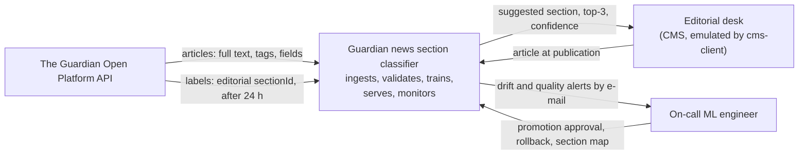
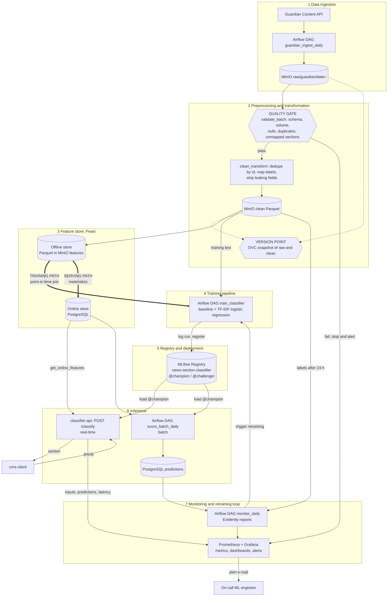
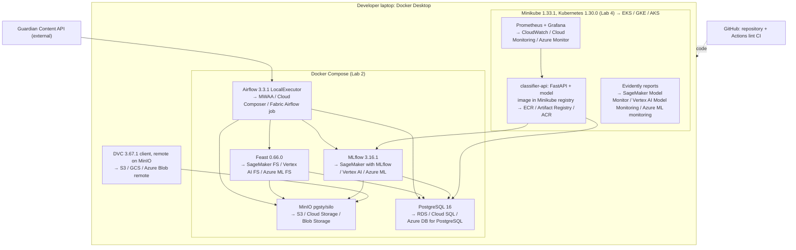
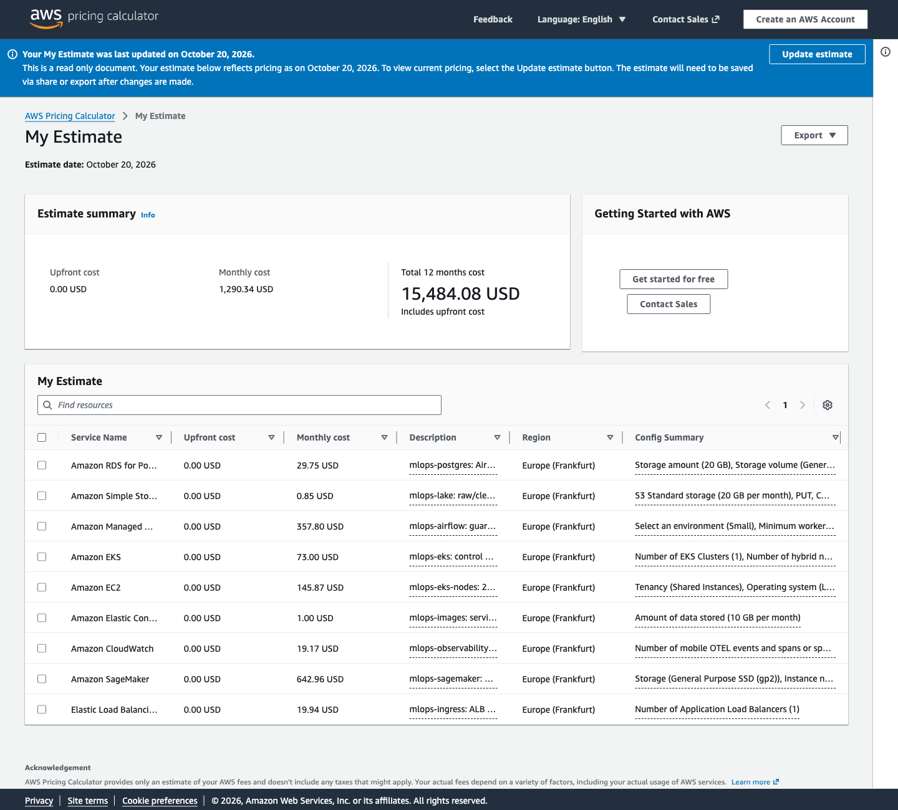
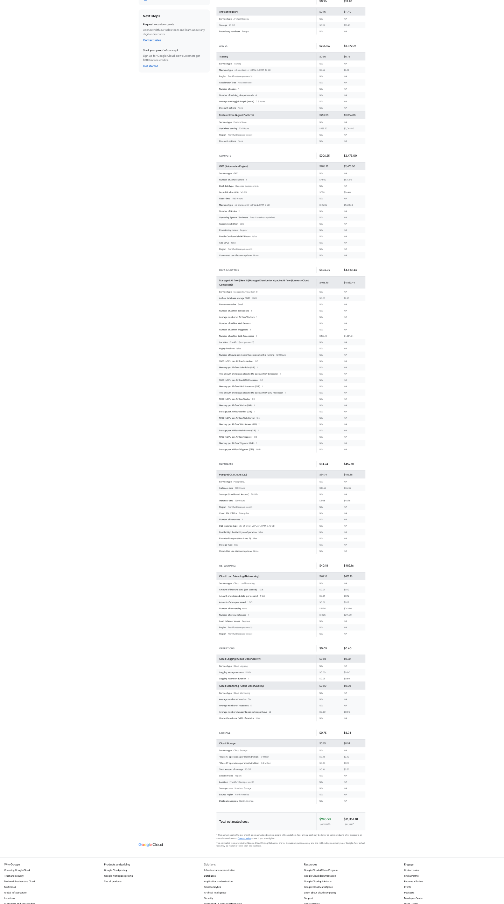
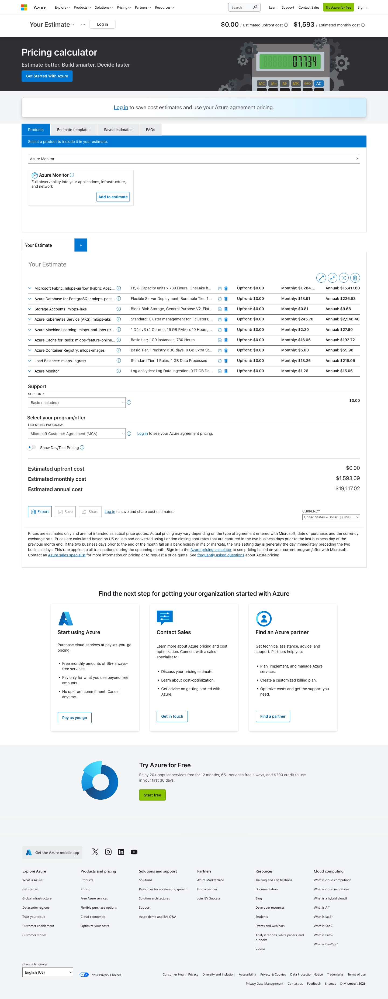

# Design document: Guardian news section classifier

| | |
|---|---|
| Course | KSE MLOps — Introduction to MLOps and ML System Design |
| Use case | Dynamic news classification (Lab 1, Appendix 1) |
| Data source | The Guardian Open Platform Content API |
| Status | Lab 1 — first version |
| Template | [eugeneyan/ml-design-docs](https://github.com/eugeneyan/ml-design-docs) |

Statements marked **Assumption:** are decisions taken without confirmed facts. Each one names what will confirm or replace it.

---

## 1 Overview

Newsrooms file every article under a section (politics, business, sport, culture, …), and doing it by hand is slow and inconsistent, while topics and vocabulary change every week. We build a system that suggests the section of a news article from its text and from metadata known at publication time, using full-text articles from The Guardian Open Platform API as both training data and the live stream. The system collects new articles daily, validates and versions them, keeps per-author and per-office features in a feature store, trains and registers models, serves predictions through an API and a daily batch, and monitors drift so that it retrains when quality degrades. The desired outcome is a reproducible pipeline whose suggestions an editor accepts for at least 85% of articles and which detects its own degradation without waiting for a person to notice.

---

## 2 Motivation

**Who consumes the predictions.**
- *Editorial desk, the only external consumer.* When an article is ready, the CMS asks the system for a suggested section and shows the top 3 to the editor. In this project the CMS is emulated by a client script (`cms-client`) that replays newly published Guardian articles.
- *Inside the system: monitoring.* A daily batch also scores every article of the previous day. Nobody outside the system reads it. It exists so that drift and quality monitoring (6.6) and the champion/challenger comparison (5.4) see all articles, not only those the CMS sent.

**How often.** Continuously during the day, one request per new article. Assumption: ~250 articles/day, to be confirmed by `response.total` of the first API call (see 5.2).

**What happens when a prediction is wrong.** The editor corrects the section by hand (Assumption: ~30 s per correction). If nobody notices, the article lands on the wrong section front and in the wrong newsletter, and loses audience. A wrong suggestion is cheap one at a time but expensive when it is systematic, for example when a new topic appears and the model keeps sending it to `world`.

**User stories.**

| # | As a… | I want… | So that… | Where in the design |
|---|---|---|---|---|
| U1 | Editor filing an article | to see a suggested section and the top 3 alternatives within a moment of pressing "suggest" | I can file the article in one click instead of choosing from the full section list | F6, `POST /classify`, p95 ≤ 300 ms |
| U2 | Editor | to pick a different section when the suggestion is wrong | the article lands on the right section front; my choice becomes the correct answer (the label) the system learns from | 5.5, override |
| U3 | Editor | to move an article to another section during its first day if the story develops | the section reflects what the article turned out to be about | 5.2, 24 h label delay |
| U4 | Editor | the CMS to keep working if the model is down | publishing is never blocked by the classifier | 4, availability and fallback |
| U5 | On-call ML engineer | an alert when the model starts going wrong, **before** the correct sections are known | I can react the same day instead of waiting for the quality numbers | 6.6, label-free signals |
| U6 | On-call ML engineer | daily macro-F1 and acceptance rate once the correct sections are known | I know whether the early alert was a real problem or a news-cycle spike | 6.6, quality after labels |
| U7 | Model owner | to compare a retrained model with the current one on the same recent articles, and promote it by hand | a new model replaces the old one only when it is really better | 5.4, 5.5 |
| U8 | Model owner | to map a new Guardian section to a project class | new sections are not silently lumped into `other` | 5.5, section map |

**Example: one article through the system, and why the label is delayed 24 h.**

| When (UTC) | What happens | What the system knows about the correct section |
|---|---|---|
| Day D, 09:40 | A journalist finishes "Heatwave closes schools across southern England". The CMS calls `POST /classify` and gets `environment` 0.62, `uk-news` 0.24, `world` 0.08. The prediction is logged to `predictions`. | Nothing yet. |
| Day D, 09:41 | The editor accepts `environment` (U1). The article is published at 10:00, which becomes its `webPublicationDate`. | The editor's choice exists in the CMS, but it may still change. |
| Day D, 15:00 | The story develops into a story about exam cancellations. The editor moves the article to `uk-news` (U3). | The section has changed. If the system had counted 09:41 as final, it would now hold a wrong label. |
| Day D+1, 03:00 | `guardian_ingest_daily` downloads all articles of day D, this one included, with its current section `uk-news`. | The section is stored, but the article is only 17 h old, so it is **not used yet**. |
| Day D+1, 10:00 | 24 h have passed since publication. | The section `uk-news` now counts as the **label**: final and safe to use. |
| Day D+2, 06:00 | `monitor_daily` joins the logged prediction (`environment`) with the label (`uk-news`). The miss counts against macro-F1 and the acceptance rate (U6). The contributor's history features now include this article. | Used for quality metrics and features. |

What the 24 h delay gives the design:
1. **It matches how the newsroom works.** A section is final only when editors stop moving the article (U3). A label taken too early would be wrong whenever the section changed later.
2. **It makes monitoring without labels a real phase.** For the first day after publication, the on-call engineer has only label-free signals: predicted-class mix, confidence, text drift and volume (U5). Labels confirm or dismiss those alerts later (U6). Without a delay, this part of the system would never be exercised, because the Guardian API returns the section together with the article.
3. **It prevents leakage.** Contributor features may use only labels the system could actually have known at that moment. Otherwise training would see information that serving never has.

Assumption: 24 h is the confirmation window. If the Guardian data shows articles changing section later than that (checked with the `last-modified` sweep in Lab 2), the window is extended.

**Why a system and not a notebook.** News changes continuously: new events bring new vocabulary, sections are reorganised, the label mix shifts with the news cycle. A model trained once in a notebook degrades silently. During dataset selection, a TF-IDF + logistic regression baseline trained on 2014–2015 HuffPost headlines fell from macro-F1 0.617 (2016) to 0.465 (first half of 2018) with no code change. The value here is in the loop around the model: periodic collection, validation, versioning, monitoring for degradation, and retraining by trigger.

---

## 3 Success metrics

Three layers, kept apart. A model can improve while the business metric does not, and the reverse.

| Layer | Metric | Target | Role | How it is measured |
|---|---|---|---|---|
| Business | **Suggestion acceptance rate**: share of articles where the top-1 suggestion equals the section the editor finally keeps | ≥ 85% (Assumption, revised after Lab 2 baseline) | Decision metric | Emulated: top-1 prediction vs Guardian's editorial `sectionId` after the 24 h label delay |
| Business | **Top-3 coverage**: final section is among the 3 suggestions | ≥ 95% (Assumption) | Secondary | Same data as above |
| Model | **Macro-F1** on the most recent fully labelled time window | ≥ 0.80 and ≥ baseline + 0.10 (Assumption) | **Optimizing** | Offline on the held-out period (5.4); online daily once labels arrive |
| Model | Per-class recall | ≥ 0.60 for every class | **Satisficing** | Same evaluation |
| System | p95 latency of `POST /classify` | ≤ 300 ms | **Satisficing** | Prometheus histogram |
| System | Data freshness: previous day ingested, validated and in the feature store | by 06:00 UTC daily | **Satisficing** | Airflow run timestamps; age of newest row in the online store |
| System | API availability | ≥ 99% during the demo window (Assumption: local single-replica deployment) | **Satisficing** | Prometheus `up` and probe results |

Macro-F1 is the optimizing metric because classes are imbalanced (sport and world dominate) and every section matters to its editor. All other metrics are thresholds that a model must satisfy, not maximise.

---

## 4 Requirements and constraints

### Functional requirements

| # | Requirement |
|---|---|
| F1 | Ingest all articles published in the previous UTC day from the Guardian Content API (`type=article`, full text, tags, fields) and store the raw responses unchanged. |
| F2 | Validate every batch (schema, volume, nulls, duplicates, unmapped sections) and stop the pipeline on failure. |
| F3 | Map Guardian `sectionId` to the project label set through a versioned mapping file. |
| F4 | Compute features per entity (contributor, production office) with event timestamps; publish them to the offline store and materialise the latest values to the online store. |
| F5 | Train a baseline and a candidate model on a time-based split; log parameters, metrics, data version and commit; register the model. |
| F6 | **Online inference.** `POST /classify` accepts `{headline, standfirst, body_text, contributor_ids[], production_office, published_at}` and returns `{section, confidence, top3[], model_version, fallback_used}`. Caller: the CMS (emulated by `cms-client`). |
| F7 | **Batch inference.** Every day, score all articles of the previous day into the `predictions` table in PostgreSQL. Caller: Airflow; readers: `monitor_daily` (drift and quality, 6.6) and the champion/challenger comparison (5.4). Internal only, no external consumer. |
| F8 | Monitor inputs, predictions and (after the delay) labels; raise an alert when a threshold is crossed; trigger retraining. |

### Non-functional requirements

| Category | Requirement |
|---|---|
| **Freshness** | Previous day's articles ingested, validated and materialised to the online store by 06:00 UTC. Online features are at most 30 h old (24 h label delay + 6 h pipeline window); older values are treated as missing. |
| **Latency and throughput** | `POST /classify` p95 ≤ 300 ms, p99 ≤ 800 ms. Sustained 1 request/s, bursts of 5 requests/s. Assumption: ~250 articles/day, peaks of ~30/hour. Daily batch scoring of one day ≤ 10 min. |
| **Availability and fallback** | API ≥ 99% during the demo window. If the model cannot be loaded, the service answers with the rule-based keyword baseline and sets `fallback_used=true`. If the online store is unreachable or the contributor is unknown, the model uses default feature values (global class prior) instead of failing. If the Guardian API is down, ingestion retries for 6 h and then alerts; the last champion keeps serving. |
| **Reproducibility** | Any registered model can be rebuilt from its MLflow run: tags `git_commit`, `data_version` (DVC hash of the training snapshot), `section_map_version`, `feature_service`. `make setup` recreates the environment from `uv.lock`; `dvc pull` restores raw snapshots without a Guardian key. |
| **Adaptability** | New data enters daily as a new date partition. New models enter through scheduled weekly retraining or a drift-triggered run, as `@challenger`, and replace `@champion` only through the promotion gate (5.4) and a human approval (5.5). New Guardian sections enter through the versioned section map; until mapped they go to `other`. |
| **Observability without ground truth** | During the 24 h before labels arrive: predicted-class distribution vs the reference window, mean confidence and share of low-confidence predictions (< 0.5), text drift on TF-IDF features, share of `other` / unmapped sections, ingested volume per day, feature freshness. After labels: macro-F1 and acceptance rate per day and per 7-day window. |
| **Cost and resource ceilings** | Local stack fits in 8 GB RAM and 4 CPU cores (Minikube 4 GB + host services). Training on CPU only, ≤ 30 min per run. Guardian API usage ≤ 400 calls/day, which keeps 20% headroom under the most restrictive reported developer limit (500/day). Raw storage ≤ 5 GB. Monthly cloud cost: $0 for the course (local); managed cloud ≈ $946–1,593/month, self-hosted variant ≈ $350–380/month (6.7). |

### In scope

- English Guardian articles of `type=article` from 2024-01-01 onwards, with full body text.
- Single-label classification into the project label set (5.1).
- Daily batch ingestion; online and batch inference; drift monitoring and retraining loop.
- Local deployment on the reference stack; cloud equivalents named, not deployed.

### Out of scope

- Live blogs, galleries, video, audio, interactives, crosswords (non-`article` types).
- Opinion pillar (`commentisfree`): opinion pieces span all topics and have their own editorial flow. Assumption: revisited after Lab 2 error analysis.
- Multi-label tagging with Guardian keyword tags; images and video.
- Languages other than English; sources other than the Guardian.
- Writing back to a real CMS; any commercial use of Guardian content.

---

## 5 Methodology

### 5.1 Problem statement

**Framing: single-label multi-class text classification.** Input: an article at publication time (headline, standfirst, body text, contributor ids, production office, publication time). Output: one of the project sections, with a probability per class.

**Label set.** Guardian `sectionId` values mapped to 12 classes by `configs/section_map.yaml` (versioned in Git):

| Class | Guardian `sectionId` values (initial mapping) |
|---|---|
| `world` | `world` |
| `uk-news` | `uk-news` |
| `us-news` | `us-news` |
| `politics` | `politics` |
| `business` | `business`, `money` |
| `technology` | `technology` |
| `science` | `science` |
| `environment` | `environment` |
| `sport` | `sport`, `football` |
| `culture` | `culture`, `film`, `music`, `books`, `tv-and-radio`, `artanddesign`, `stage`, `games` |
| `lifestyle` | `lifeandstyle`, `fashion`, `food`, `travel` |
| `other` | any section not listed above |

Assumption: the mapping is final only after counting `sectionId` frequencies over one month of real data; classes below 1% of volume are merged.

**Rejected framing: multi-label classification over Guardian keyword tags.** It would be closer to how the Guardian tags content, but keyword tag ids start with the section name (`football/premierleague`), so they leak the label. The label space is also thousands of tags with a long tail, and per-tag evaluation would be meaningless with our data volume. A second rejected option, the 5 `pillarName` values (News, Opinion, Sport, Arts, Lifestyle), is too coarse to be useful to an editor.

### 5.2 Data

**Source.** The Guardian Open Platform Content API, `https://content.guardianapis.com/search`. Owner: Guardian News & Media. Access: free developer key, non-commercial use; Guardian staff have confirmed that student projects are allowed.

**Request per batch.**
```
/search?from-date=D&to-date=D&use-date=published&type=article
       &order-by=oldest&page-size=200&page=N
       &show-fields=headline,standfirst,trailText,bodyText,byline,wordcount,
                    firstPublicationDate,lastModified,productionOffice,lang
       &show-tags=contributor,keyword,tone,series
       &api-key=$GUARDIAN_API_KEY
```

**Arrival pattern.** Articles are published continuously. The pipeline collects them as one daily batch per UTC day (`guardian_ingest_daily`, 03:00 UTC). A second query with `use-date=last-modified` picks up articles changed in the last 3 days, so corrections reach the raw layer.

**Volume.** Assumption: ~250 articles/day, ~1–3 calls/day. To be replaced by the measured `response.total` of a sample week.

**History.** Backfill 2024-01-01 → 2026-09-30 (33 months, Assumption: ~250k articles). Paged by month at 200 articles per call, that is ~1,300 calls, or about 4 days of runs capped at 400 calls/day.

**Labels and their delay.**
- The label is the editorial `sectionId`, mapped to the project class.
- **The Guardian API gives the label immediately, but the system pretends it arrives 24 h later.**
  - In the API, every article already comes with its `sectionId`, so technically the label is known right away.
  - In a real newsroom the final section is confirmed by an editor some time after publication. To emulate this, the system treats the label as **unknown for the first 24 h** after `webPublicationDate`.
  - This makes "monitoring without labels" (6.6) a real phase: for the first 24 h, only signals that need no label are available.
  - A step-by-step example of one article, with the user stories behind the rule, is in 2 (Motivation).
- **What the 24 h rule means in practice:**
  - Quality metrics (macro-F1, acceptance rate) are computed only on articles published more than 24 h ago.
  - Contributor and office history features (5.3) count only articles older than 24 h, so they never use a label the system should not know yet.
  - The model never receives the label as an input; at serving time the section is what it predicts.
- A label changes if the Guardian moves the article; the `last-modified` sweep records the change.

**Available at serving time vs training time.**

| Data | Training | Serving (at publication) |
|---|---|---|
| `headline`, `standfirst`, `bodyText`, `wordcount` | ✅ | ✅ in the request |
| Contributor tag ids, `productionOffice`, publication time, tone tag | ✅ | ✅ in the request |
| Contributor and office history features | ✅ point-in-time from the offline store | ✅ latest value from the online store (labels older than 24 h only) |
| `sectionId`, `sectionName`, `pillarName` | ✅ as **target only** | ❌ (that is what we predict) |
| `id`, `webUrl`, keyword / series / newspaper-section tags | ❌ excluded (leak the label) | ❌ |
| Later edits (`lastModified` > publication) | ❌ only the first-seen version is used for training | ❌ |

**Storage layers.**
- **raw:** JSON responses exactly as received, partitioned `raw/guardian/date=YYYY-MM-DD/page-N.json` in MinIO, immutable.
- **clean:** Parquet, one row per article (deduplicated by `id`, first-seen version), typed columns, mapped label, partitioned by `date=`.
- **features:** Parquet with `event_timestamp` per entity (Feast offline source), plus the PostgreSQL online store.
- **Versioning:** DVC tracks a snapshot of the raw and clean layers (`dvc add`), remote in the MinIO `dvc` bucket. The DVC hash is the data version.

**Dataset checklist (Lab 1, step 1).**

| Item | Justification |
|---|---|
| Time axis | Every article has `webPublicationDate` to the second; the API filters by `from-date`/`to-date`, so "next day" and "next month" batches are real requests, not a replay. New data keeps arriving, so Lab 4 can observe real drift as well as emulate it. |
| History to hold out a period | 33 months of backfill (2024-01 → 2026-09). Hold-out: 2026-04 → 2026-06 as test; 2026-07 → 2026-09 replayed as "production" months; live data after that (5.4). |
| Labels with known delay | Editorial `sectionId` on every article. Delay: 24 h, emulated as an editor confirmation window (Assumption, chosen to make monitoring without labels a real phase). |
| Text surface or corpus | Full article body text (`bodyText`, Assumption: median several hundred words). The same corpus is the document base for the Lab 3 retrieval component. |

### 5.3 Techniques

**Baseline first: rule-based keyword classifier.** For each class, a lexicon of 20–40 keywords is built once from training-period headlines (most discriminative terms, reviewed by hand). An article is assigned to the class with the most keyword hits in headline + standfirst, with ties going to the most frequent class. It needs no model file, runs in microseconds, and is the **production fallback** (4, Availability).

**Candidate: TF-IDF + logistic regression with metadata features** (scikit-learn).
- Text: headline, standfirst and the first 300 words of the body, word 1–2-grams, sublinear TF.
- Metadata: one-hot production office and tone tag, publication hour, log word count.
- Feature-store features: contributor and office history (below).
- One-vs-rest logistic regression with class weights.

It trains in minutes on CPU, is reproducible and is easy to explain. A transformer fine-tune is an alternative for later (7.1), not a requirement.

**Features and their serving-time source.**

| Feature | Entity | Computation | Training source | Serving source |
|---|---|---|---|---|
| `tfidf(headline + standfirst + body[:300])` | article | vectoriser fitted on the training window | clean Parquet | request body |
| `log_wordcount` | article | `log1p(wordcount)` | clean Parquet | request body |
| `pub_hour`, `pub_weekday` | article | from `published_at` | clean Parquet | request body |
| `tone` | article | tone tag (news, comment, interview, …) | clean Parquet | request body |
| `production_office` | article | one-hot UK / US / AUS | clean Parquet | request body |
| `contrib_class_share_30d[k]` | contributor | share of the contributor's articles in class k over the last 30 days, **labels older than 24 h only** | Feast offline store, point-in-time join | Feast online store, key = `contributor_id` |
| `contrib_articles_30d` | contributor | count over the last 30 days | Feast offline store | Feast online store |
| `office_class_share_7d[k]` | production office | class distribution over the last 7 days | Feast offline store | Feast online store, key = `production_office` |

For articles with several contributors, contributor features are averaged. An unknown contributor gets the global class prior and `contrib_articles_30d = 0`.

**Training/serving skew guard.** Text preprocessing and feature code live in one package imported by the training pipeline, the batch scorer and `classifier-api`. Contributor features are defined once as Feast feature views (`contributor_stats`, `office_stats`) and served through one Feast feature service (`section_classifier_v1`) for both training and serving.

### 5.4 Experimentation and validation

**Split strategy: time-based, never random.** News is ordered in time: the same story produces many near-duplicate articles over a few days, and vocabulary from a future event must not leak into training.

| Window | Period | Use |
|---|---|---|
| Train | 2024-01-01 → 2025-12-31 | Fit vectoriser and model |
| Validation | 2026-01-01 → 2026-03-31 | Hyperparameters, threshold choices |
| Test (held out) | 2026-04-01 → 2026-06-30 | Single final offline report per model version |
| Production replay | 2026-07-01 → 2026-09-30 | Lab 2 "next month" ingestion, Lab 4 drift emulation |
| Live | 2026-10 onwards | Real daily ingestion and monitoring |

**Leakage it prevents:**
- future events and vocabulary in training;
- the same story (or the same article in a later edited version) on both sides of the split, so articles are deduplicated by `id`, keeping the first-seen version;
- contributor statistics computed with labels from the future, which point-in-time joins and the 24 h label delay rule out;
- label leakage through URLs and keyword tags, which are excluded (5.2).

**Offline metric.** Macro-F1 on the test window, plus per-class recall and the confusion matrix. A rolling-origin check (train up to month M, test on M+1, for the last 6 months) measures how fast quality decays, which sets the retraining cadence.

**Comparing a new model with the current one.** Both models are scored on **the same most recent fully labelled window** (the last 14 days with labels). The challenger is promoted to `@champion` only if all of these hold:
1. macro-F1 ≥ champion + 0.01;
2. no class recall drops by more than 0.05;
3. p95 latency in a load test ≤ 300 ms;
4. it beats the keyword baseline by ≥ 0.10 macro-F1;
5. a human approves (5.5).

Results are logged to MLflow; the comparison report is attached to the challenger's run.

### 5.5 Human in the loop

| Situation | Who | Action and expected response time |
|---|---|---|
| Drift or quality alert | On-call ML engineer (in this project: the repository owner) | Receives a Grafana alert by e-mail and opens the Evidently report within 1 working day. Decides: ignore (news-cycle spike), update the section map, or start retraining. Decision logged in `docs/incidents.md`. |
| Model promotion | Model owner | Reviews the challenger-vs-champion report in MLflow and moves the `@champion` alias by hand. The automatic gate (5.4) only proposes. |
| Rollback | Model owner | Points `@champion` back to the previous version; `classifier-api` reloads on the next readiness check. |
| Override of a prediction | Editor (emulated) | Picks a different section in the CMS. The final section is stored as the label with `source=editor`, and the disagreement counts against the acceptance rate. |
| New Guardian section appears | Model owner | Adds it to `configs/section_map.yaml` (versioned). Until then it maps to `other`, which is monitored. |

---

## 6 Implementation

### 6.1 High-level design

#### System context



#### Data flow on the seven layers



The three required marks:
1. **Version point:** DVC snapshot of the raw and clean layers. Every MLflow run is tagged with its hash.
2. **Quality gate:** `validate_batch`, before anything reaches the clean layer or the feature store.
3. **Where training and serving diverge:** the offline side of Feast feeds `train_classifier` through point-in-time joins; the online side, materialised to PostgreSQL, feeds `classifier-api` and `score_batch_daily`.

#### Deployment, first draft



### 6.2 Infra

| Component | Role in this system | Local (pinned) | AWS | GCP | Azure |
|---|---|---|---|---|---|
| Object storage | Raw JSON, clean and feature Parquet, MLflow artifacts, DVC remote | MinIO-compatible `pgsty/silo` (buckets `raw`, `clean`, `features`, `mlflow`, `dvc`) | Amazon S3 | Cloud Storage | Blob Storage |
| Data versioning | Snapshot of raw and clean layers; data version = DVC hash | DVC 3.67.1 + dvc-s3 3.3.0, remote on MinIO | S3 remote | GCS remote | Azure Blob remote |
| Database | Feast online store, MLflow backend, `predictions` table, Airflow metadata | PostgreSQL 16 | Amazon RDS | Cloud SQL | Azure Database for PostgreSQL |
| Orchestrator | DAGs `guardian_ingest_daily` (tasks `validate_batch`, `clean_transform`), `score_batch_daily`, `monitor_daily`, `train_classifier` | Apache Airflow 3.3.1, LocalExecutor | Amazon MWAA | Cloud Composer | Apache Airflow job in Microsoft Fabric (Data Factory's managed Airflow is closed to new instances, see 6.7) |
| Tracking and registry | Runs, metrics, lineage tags; model `news-section-classifier` with aliases | MLflow 3.16.1 (PostgreSQL backend, MinIO artifacts) | SageMaker with MLflow | Vertex AI Experiments and Model Registry | Azure ML with MLflow |
| Feature store | Feature views `contributor_stats`, `office_stats`; feature service `section_classifier_v1` | Feast 0.66.0 (offline: Parquet in MinIO; online: PostgreSQL) | SageMaker Feature Store | Vertex AI Feature Store | Azure ML managed feature store |
| Model service | `classifier-api`: FastAPI, loads `@champion`, serves `POST /classify`, `/health`, `/ready`, `/metrics` | Container on Minikube | Amazon EKS | GKE | AKS |
| Container registry | Images of `classifier-api` tagged with the commit | Minikube built-in registry | Amazon ECR | Artifact Registry | Azure Container Registry |
| Kubernetes cluster | Runs serving and monitoring in Lab 4 | Minikube 1.33.1 (Kubernetes 1.30.0, docker driver, 4 GB) | Amazon EKS | GKE | AKS |
| Model and data monitoring | Text, prediction and label drift reports | Evidently | SageMaker Model Monitor | Vertex AI Model Monitoring | Azure ML model monitoring |
| Metrics and dashboards | Latency, throughput, freshness, alerts | Prometheus, Grafana | Amazon CloudWatch | Cloud Monitoring | Azure Monitor |
| Local runtime | Runs the Lab 2 services together | Docker Desktop + Docker Compose | — (replaced by the managed services above) | — | — |
| Code and CI | Repository, lint CI (tests from Lab 2) | GitHub + GitHub Actions | GitHub Actions (same) | GitHub Actions (same) | GitHub Actions (same) |
| External data source | Articles and labels | The Guardian Open Platform Content API | — | — | — |
| Consumer emulator | Replays new articles to `POST /classify` | `cms-client` Python script | — | — | — |

Lab 1 runs nothing but CI. Lab 2 starts MinIO, PostgreSQL, Airflow, MLflow and Feast with Docker Compose; Lab 4 moves serving and monitoring to Minikube. Lab 3 adds a vector store (pgvector or Qdrant) and an LLM; this table is revised then.

### 6.3 Performance

| Item | Budget | Basis |
|---|---|---|
| Online throughput | 1 req/s sustained, 5 req/s burst | Assumption: ~250 articles/day, peaks ~30/hour; editors may re-request on edits |
| Online latency | p95 ≤ 300 ms, p99 ≤ 800 ms end to end | TF-IDF + linear model ≈ few ms; online store lookup ≈ 10–20 ms; rest is network and JSON |
| Batch scoring | One day (~250 articles) ≤ 10 min, finished by 06:00 UTC | Runs after ingestion and materialisation |
| Training | ≤ 30 min on 4 CPU cores | ~180k training articles, sparse linear model |
| Ingestion | ≤ 3 API calls/day steady state; backfill ≤ 400 calls/day | Rate-limit headroom (4, cost row) |
| Storage | Raw ≤ 5 GB, clean Parquet ≤ 1 GB | Assumption: ~10 KB raw JSON per article incl. tags |

**Batch versus online: online for the consumer, batch for monitoring.**
- **Online.** The editorial desk needs the suggestion while the editor is filing the article, so a nightly batch would arrive too late. This is the only path an external consumer uses.
- **Batch.** A daily batch serves the system itself, not a consumer. It is needed for three reasons:
  - `classifier-api` only sees the articles the CMS sends. The batch scores every article of the day with one model version, so drift and quality metrics (6.6) cover all of them.
  - The champion/challenger comparison (5.4) needs both models scored on the same window, which is a batch job by nature.
  - Lab 4 emulates drift by replaying whole months (2026-07 → 2026-09). Batch-scoring the replayed days does this without pushing thousands of requests through the API.
- Both paths load the same `@champion` and the same Feast feature service, so they cannot diverge.

### 6.4 Security

- **Secrets.**
  - `GUARDIAN_API_KEY`, MinIO and PostgreSQL credentials live in `.env`, which is git-ignored; `.env.example` with empty values is committed.
  - Airflow reads them as connections and variables; in Lab 4 they become Kubernetes Secrets.
  - CI needs no secrets in Lab 1. If later CI jobs need the Guardian key, it goes into GitHub Actions Secrets, never into a workflow file.
- **Who may call the service.** `classifier-api` is reachable only inside the Minikube cluster and through `kubectl port-forward`. Assumption: a static bearer token for `POST /classify` (from a Kubernetes Secret) is enough for the course. `/health` and `/metrics` stay unauthenticated inside the cluster.
- **Supply chain.** Dependencies are pinned in `uv.lock`; images are tagged with the commit hash; ruff runs in pre-commit and CI.
- **Guardian key protection.** Requests stay under the daily limit (4); on HTTP 403/429 the DAG backs off and alerts instead of retrying in a loop.

### 6.5 Data privacy

- **Personal data in the dataset.** Article texts are public journalism but mention named people. Bylines and contributor tags identify journalists, and the contributor id is used as a feature-store entity. No reader data, user accounts or behaviour logs are collected.
- **Minimisation.** Only the fields listed in 5.2 are requested; contributor emails, Twitter handles and bios in tag objects are dropped in the clean layer.
- **Retention.** Raw responses are kept for the course duration plus 3 months, then deleted. Assumption: storing article text for non-commercial research is within the Open Platform terms; to be confirmed when the key is issued. Feature-store rows keep only aggregates (counts and shares), not text.
- **Takedowns.** The weekly `last-modified` sweep checks `isGone` / `isExpired`. Removed articles are deleted from raw and clean and excluded from future training snapshots.
- **No redistribution.** Raw and clean data never go into the Git repository or a public bucket; the DVC remote is a private MinIO bucket.

### 6.6 Monitoring and alarms

First draft; Lab 4 makes it real.

**What is logged.**
- Every online and batch prediction to `predictions`: `article_id`, `model_version`, `section`, `confidence`, `top3`, `fallback_used`, `latency_ms`, `request_ts`.
- Request metrics to Prometheus.
- Pipeline task outcomes and row counts from Airflow.

**Metrics and thresholds.**

| Signal | Metric | Threshold | Window | Alert to |
|---|---|---|---|---|
| Freshness | Age of the newest article in clean / online store | > 30 h | checked hourly | On-call ML engineer (e-mail) |
| Volume | Articles ingested for day D vs median of the previous 28 days | < 50% or > 200% | daily | On-call |
| **Stale partition** | Ingested `max(webPublicationDate)` ≠ the run's logical date `ds` (the job read an old partition while "succeeding") | any mismatch | daily | On-call |
| Quality gate | `validate_batch` failed | any failure | per run | On-call |
| Unmapped sections | Share of `other` / unmapped `sectionId` | > 5% | daily | On-call; model owner updates the section map |
| Prediction drift | Jensen–Shannon distance of the predicted-class distribution vs the reference (training) window | > 0.1 | 7-day rolling | On-call |
| Input drift | Evidently text-drift test on TF-IDF features vs reference | drift detected | 7-day rolling | On-call |
| Confidence | Share of predictions with confidence < 0.5 | > 25% | daily | On-call |
| Quality (after labels) | Macro-F1 of the last 7 labelled days | < 0.75 or drop > 0.05 from test score | daily | On-call → triggers `train_classifier` |
| Fallback use | Share of `fallback_used = true` | > 1% | 1 h | On-call |
| Service | p95 latency; 5xx rate | > 300 ms; > 1% | 5 min | On-call |
| API limits | Guardian HTTP 403/429 responses | any | per run | On-call |

**Who receives alerts.** Grafana alerting sends an e-mail to the on-call ML engineer (the repository owner). Retraining is triggered automatically by the quality rule; promotion still needs approval (5.5).

### 6.7 Cost

**Course setup: $0 cloud spend.** Labs 1–5 run on a laptop (Docker Compose, Minikube) with a free Guardian developer key. The figures below answer a different question: what would it cost to run the managed column of 6.2 in a real cloud?

**How the estimate was made.**
- Each component of 6.2 was entered into the official calculator of each cloud on 2026-10-20: [AWS Pricing Calculator](https://calculator.aws/#/), [Google Cloud Pricing Calculator](https://cloud.google.com/products/calculator), [Azure Pricing Calculator](https://azure.microsoft.com/en-us/pricing/calculator/).
- Sizing follows 6.3: ~250 articles/day, 1 req/s, raw ≤ 5 GB, one training run per week of ≤ 30 min on 4 vCPU, a daily drift job.
- Saved estimates:
  - AWS: [public estimate link](https://calculator.aws/#/estimate?id=96339b91c26160458899ac5e0dea97e5d9e6fd7c), valid for one year.
  - Google Cloud: [estimate summary](https://cloud.google.com/products/calculator/estimate-preview/CiRlZjBiMjBiMi1jNjcyLTRlZTEtYTIxYS0wODlkNWQ5NWU1ZDkQAQ%3D%3D).
  - Azure: sharing requires a login, so the calculator exports are committed: [`cost/azure-estimate.xlsx`](cost/azure-estimate.xlsx) (with managed Airflow) and [`cost/azure-estimate-adf.xlsx`](cost/azure-estimate-adf.xlsx) (Data Factory instead of Airflow).

**Assumptions.**
- Assumption: region Frankfurt (AWS eu-central-1, GCP europe-west3, Azure Germany West Central). It is close to the Guardian's European audience and is the same region in all three clouds.
- Assumption: on-demand prices, 730 h/month, USD, before tax.
- Assumption: no free tier, credits, committed-use discounts or support plan. One environment, no high availability.
- Assumption: data transfer is negligible at this volume and is left out, except for load balancer processing.
- Calculator limitations:
  - The Azure Monitor block reset its region to East US every time it reloaded, so that one line ($1.26) uses East US prices.
  - The GKE line does not apply the GKE free-tier credit for one zonal cluster.
- Assumption: managed Airflow on Azure is an Apache Airflow job in Microsoft Fabric.
  - Data Factory's Workflow Orchestration Manager, the earlier managed Airflow, accepts no new instances since 2026-01-01 ([Microsoft docs](https://learn.microsoft.com/azure/data-factory/airflow-pricing)).
  - A small custom pool (always on, needed for a 24/7 scheduler) uses 5 capacity units (CU), and Microsoft names F8 as the minimum capacity for it ([Airflow compute in Fabric](https://learn.microsoft.com/fabric/data-factory/apache-airflow-compute), [pricing](https://learn.microsoft.com/fabric/data-factory/pricing-apache-airflow-job)). The calculator prices Fabric as the whole F8 capacity.

**Monthly estimate per component (USD).**

| Component (6.2) | AWS | Google Cloud | Azure |
|---|---|---|---|
| Object storage, 20 GB + requests | S3: 0.85 | Cloud Storage: 0.75 | Blob Storage (Hot, LRS): 0.81 |
| PostgreSQL, smallest burstable instance, 20 GB | RDS db.t4g.small, Single-AZ: 29.75 | Cloud SQL db-g1-small: 34.74 | Flexible Server B1ms, 32 GiB minimum disk: 18.91 |
| Orchestrator, always on | MWAA, Small environment: **357.80** | Managed Service for Apache Airflow Gen 3 (formerly Cloud Composer), Small: **406.95** | Microsoft Fabric F8 capacity for an Apache Airflow job, small custom pool: **1,284.80** |
| Tracking and registry | SageMaker managed MLflow, small tracking server 24/7: **638.51** | No managed MLflow: MLflow runs on the GKE nodes; Vertex AI Model Registry has no separate charge: 0 | MLflow tracking is built into the Azure ML workspace: 0 |
| Feature store | SageMaker Feature Store, on-demand (10k writes, 100k reads): 0.60 | Vertex AI Feature Store (listed as "Agent Platform" in the calculator), 1 online serving node 24/7: **255.50** | Azure ML managed feature store; online store Azure Cache for Redis C0: 16.06 |
| Training and drift jobs | SageMaker Training 4 × 0.5 h ml.m5.xlarge + Processing 30 × 0.25 h ml.m5.large: 3.85 | Vertex AI Training 4 × 0.5 h n1-standard-4: 0.56 (drift job runs on GKE) | Azure ML compute D4s v3, 10 h: 2.30 |
| Kubernetes: control plane + 2 nodes (2 vCPU, 8 GB) + disks | EKS 73.00 + 2 × t3.large 145.87: 218.87 | GKE zonal cluster + 2 × e2-standard-2: 206.25 | AKS Standard tier + 2 × D2s v5: 245.70 |
| Container registry, 10 GB | ECR: 1.00 | Artifact Registry: 0.95 | ACR Basic: 5.00 |
| Metrics, logs, alerts | CloudWatch: 19.17 | Cloud Logging + Monitoring: 0.05 | Azure Monitor: 1.26 |
| Load balancer in front of `classifier-api` | ALB: 19.94 | Cloud Load Balancing, regional: 40.18 | Load Balancer Standard: 18.26 |
| **Total per month** | **1,290.34** | **945.93** | **1,593.09** |
| Total per year | 15,484 | 11,351 | 19,117 |

Azure without Airflow: replacing the Fabric line with Data Factory pipelines, billed per activity run ($3.55), gives **$311.84/month** ([`cost/azure-estimate-adf.png`](cost/azure-estimate-adf.png)). It is not like-for-like: every Airflow DAG would be rewritten as a Data Factory pipeline.

**What the numbers say.**
- **The model itself is almost free.**
  - Training and drift jobs cost under $5/month in every cloud, and storage is under $1.
  - This matches the guiding principle: a simple model with a cheap, reproducible rebuild.
- **The bill comes from always-on managed control planes.**
  - Three components that are idle almost all day account for 70–81% of every total:
    - managed Airflow: $358–407 on AWS and Google Cloud, $1,285 on Azure;
    - the managed MLflow server on AWS: $639;
    - the online feature store node on GCP: $256.
  - Our DAGs run for minutes per day, and the model is called about 250 times a day.
- **Azure is the most expensive like-for-like, and the cheapest without Airflow.**
  - Managed Airflow on Azure only runs inside a Fabric capacity, sold in fixed sizes. Airflow needs 5 CU, so the smallest fitting size is F8, and 3 of its 8 CU are paid for but unused.
  - Everything else on Azure is cheap: MLflow tracking is free inside the Azure ML workspace, and the feature store's online store is a $16 Redis cache.
  - Switching to Data Factory brings Azure to $312, but only by giving up Airflow.
- **Kubernetes is the floor.**
  - The cluster with two small nodes costs $206–246 in every cloud.
  - The control-plane fee ($73 on EKS, GKE and AKS Standard) is a large part of that floor.

**Cheaper variant: managed basics, self-hosted MLOps tools.**
- This variant runs Airflow, MLflow and Feast on the Kubernetes cluster, as they already run locally. Only object storage, PostgreSQL, the registry and the cluster stay managed, and one more node is added for the extra pods.
- Derived from the calculator line items above:
  - AWS: 1,290 − 358 (MWAA) − 639 (MLflow) − 1 (Feature Store) + 73 (third t3.large) ≈ **$366/month**.
  - Google Cloud: 946 − 407 (Airflow) − 256 (Feature Store) + 67 (third e2-standard-2) ≈ **$350/month**.
  - Azure: 1,593 − 1,285 (Fabric) − 16 (Redis) + 86 (third D2s v5) ≈ **$378/month**.
- With this variant all three clouds cost about the same, ~$350–380/month.
- Price of the variant: we operate Airflow and MLflow ourselves, including upgrades, backups of their PostgreSQL schemas, and on-call.

**Decision (Assumption, revisited in Lab 4).** If the system leaves the laptop, the self-hosted variant on any cloud is the default at this scale: ~$350–380/month, against $946–1,593/month for the fully managed setups. Azure with Data Factory ($312) is cheaper still, but it replaces Airflow and would mean rewriting the pipelines.
- Managed Airflow pays off once there are many DAGs or several teams.
- Managed MLflow and an online feature store node pay off once traffic is far above ~250 requests/day.
- A first step down in cost is spot or preemptible nodes for the batch workloads, together with the GKE free-tier credit.

**Calculator screenshots and what each line is for.** Each screenshot is followed by its calculator lines: the plan entered, the job it does in this system (components of 6.2), and why that plan was chosen. Line names (`mlops-…`) are the custom names typed into the calculators.

**AWS Pricing Calculator: $1,290.34/month** ([public estimate](https://calculator.aws/#/estimate?id=96339b91c26160458899ac5e0dea97e5d9e6fd7c))



| Calculator line | Plan entered | What it does in our system | Why this plan | USD/month |
|---|---|---|---|---|
| Amazon RDS for PostgreSQL, `mlops-postgres` | db.t4g.small, Single-AZ, 20 GB general-purpose SSD | One database for Airflow metadata, the MLflow backend, the Feast online store and the `predictions` table | Smallest burstable class: the load is a few hundred writes a day. Single-AZ because high availability is out of scope (assumptions above) | 29.75 |
| Amazon S3, `mlops-lake` | S3 Standard, 20 GB, PUT and GET requests | Raw JSON, clean and feature Parquet, MLflow artifacts, DVC remote | Standard class, because training and drift jobs read the data every day. 20 GB covers the 5 GB raw ceiling plus derived layers and artifacts | 0.85 |
| Amazon MWAA, `mlops-airflow` | Small environment, minimum 1 worker, 730 h | Runs the DAGs `guardian_ingest_daily`, `score_batch_daily`, `monitor_daily`, `train_classifier` | Smallest environment class. Four DAGs that run for minutes a day need no more. The environment cannot be stopped, so it is billed 24/7 | 357.80 |
| Amazon EKS, `mlops-eks` | 1 cluster, standard support | Kubernetes control plane for `classifier-api` and monitoring (Lab 4) | One cluster for one environment | 73.00 |
| Amazon EC2, `mlops-eks-nodes` | 2 × t3.large (2 vCPU, 8 GB), on-demand, Linux | Worker nodes of the EKS cluster | 8 GB per node covers the local 4 GB Minikube budget with headroom. Two nodes, so one node restart does not stop serving | 145.87 |
| Amazon ECR, `mlops-images` | 10 GB stored | Images of `classifier-api` tagged with the commit | Billed per GB, and 10 GB keeps the recent image history | 1.00 |
| Amazon CloudWatch, `mlops-observability` | Metrics, log ingestion, alarms | Latency, throughput and freshness metrics and alerts (Prometheus and Grafana locally) | Pay per use, no fixed fee | 19.17 |
| Amazon SageMaker, `mlops-sagemaker` | Managed MLflow, small tracking server 24/7 (638.51); Training 4 × 0.5 h ml.m5.xlarge and Processing 30 × 0.25 h ml.m5.large (3.85); Feature Store on-demand, 10k writes and 100k reads (0.60) | Experiment tracking and the model registry; weekly training; the daily drift job; the feature store for `contributor_stats` and `office_stats` | Smallest MLflow server size. Training on 4 vCPU for ≤ 30 min, per 6.3; drift on 2 vCPU. Feature Store on-demand, because ~250 reads a day are far too few for provisioned capacity | 642.96 |
| Elastic Load Balancing, `mlops-ingress` | 1 Application Load Balancer | HTTPS entry point to `classifier-api` (`POST /v1/classify`, health checks) | ALB, because the API is HTTP with path versioning | 19.94 |

**Google Cloud Pricing Calculator: $945.93/month** ([estimate summary](https://cloud.google.com/products/calculator/estimate-preview/CiRlZjBiMjBiMi1jNjcyLTRlZTEtYTIxYS0wODlkNWQ5NWU1ZDkQAQ%3D%3D); the calculator with the share dialog: [`cost/gcp-calculator.png`](cost/gcp-calculator.png))



| Calculator line | Plan entered | What it does in our system | Why this plan | USD/month |
|---|---|---|---|---|
| Managed Airflow Gen 3 (formerly Cloud Composer) | Small environment; 1 scheduler, 1 worker, 1 web server, 1 triggerer, 1 DAG processor; 730 h | Runs the four Airflow DAGs | Smallest environment size, not highly resilient | 406.95 |
| Feature Store (listed under "Agent Platform") | Optimized online serving, 1 node, 730 h | Serves `contributor_stats` and `office_stats` to `classifier-api` at request time | Online serving needs at least one node running 24/7. The offline store lives in Cloud Storage, already counted | 255.50 |
| GKE (Kubernetes Engine) | 1 zonal cluster; 2 × e2-standard-2 (2 vCPU, 8 GB); 30 GB balanced boot disk; regular provisioning | Runs `classifier-api`, monitoring, the MLflow server (no managed MLflow on Google Cloud) and the daily drift job | Zonal cluster, because multi-zone HA is out of scope. Node size matches the other clouds | 206.25 |
| PostgreSQL (Cloud SQL) | Enterprise edition, db-g1-small (1 vCPU, 1.7 GB), 20 GB SSD, no HA | Same shared database as on AWS | Smallest shared-core instance that fits four light workloads | 34.74 |
| Cloud Load Balancing | Regional, 1 forwarding rule, 1 proxy instance, ~1 GB processed | HTTPS entry point to `classifier-api` | Regional, because all users and services are in one region | 40.18 |
| Artifact Registry | 10 GB, Europe | Images of `classifier-api` | Same image history as on AWS | 0.95 |
| Cloud Storage | Standard, regional europe-west3, 20 GB, 0.2 million Class B operations | Data lake, MLflow artifacts, DVC remote, Feature Store offline data | Standard class for data read daily; regional, next to the compute | 0.75 |
| Training (Vertex AI) | n1-standard-4 (4 vCPU, 15 GB), 1 node, 4 jobs × 0.5 h | Weekly training of the classifier | 4 vCPU and ≤ 30 min per run, per 6.3 | 0.56 |
| Cloud Logging and Cloud Monitoring | 5 GB of logs; 50 metrics on 5 resources | Logs, metrics and alerts | Within the free allotments, so the charge is near zero | 0.05 |

**Azure Pricing Calculator: $1,593.09/month** (full page; exported as [`cost/azure-estimate.xlsx`](cost/azure-estimate.xlsx))



| Calculator line | Plan entered | What it does in our system | Why this plan | USD/month |
|---|---|---|---|---|
| Microsoft Fabric, `mlops-airflow` | F8 capacity (8 CU), pay-as-you-go, 730 h | Hosts the Apache Airflow job (small custom pool) that runs the four DAGs | The only managed Airflow on Azure today. A small always-on pool uses 5 CU, and Microsoft names F8 as its minimum capacity, so F4 (4 CU) would be too small | 1,284.80 |
| Azure Database for PostgreSQL, `mlops-postgres` | Flexible Server, Burstable B1ms (1 vCore), 32 GiB Premium SSD, LRS | Same shared database as on AWS | Smallest burstable size. 32 GiB is the smallest disk the service offers | 18.91 |
| Storage Accounts, `mlops-lake` | Block blob, General Purpose v2, Hot tier, LRS, 20 GB, about 270k operations | Data lake, MLflow artifacts, DVC remote, offline feature store | Hot tier, because the data is read daily; LRS, because the data can be re-collected from the Guardian API | 0.81 |
| Azure Kubernetes Service, `mlops-aks` | Standard tier (with SLA), 1 cluster; 2 × D2s v5 (2 vCPU, 8 GB); 2 × E4 managed disks | Runs `classifier-api` and monitoring (Lab 4) | Standard tier, so the control plane has an uptime SLA, as on EKS and GKE. Node size matches the other clouds | 245.70 |
| Azure Machine Learning, `mlops-aml-jobs` | D4s v3 (4 vCPU, 16 GB), 10 h pay-as-you-go | Weekly training (4 × 0.5 h) and the daily drift job (30 × 0.25 h); the workspace also provides MLflow tracking and the model registry at no charge | Compute is billed only while jobs run. 9.5 h of jobs rounded up to 10 h | 2.30 |
| Azure Cache for Redis, `mlops-feature-online` | Basic tier, C0 (250 MB), 730 h | Online store of the Azure ML managed feature store | Smallest cache. Basic has no SLA, which is acceptable because features can be recomputed from the offline store | 16.06 |
| Azure Container Registry, `mlops-images` | Basic tier, 10 GB included, no extra egress | Images of `classifier-api` | Lowest tier. It already includes the 10 GB we need | 5.00 |
| Load Balancer, `mlops-ingress` | Standard tier, 1 rule, 1 GB processed | Entry point to `classifier-api` on AKS | Standard tier is required for AKS clusters | 18.26 |
| Azure Monitor | 0.17 GB of logs per day, metric alerts on 10 resources (East US prices, see assumptions) | Logs, metrics and alerts | Pay per use, matching our low volumes | 1.26 |

Without Airflow, Azure costs $311.84/month: the Fabric line is replaced by Data Factory pipelines billed per activity run ($3.55). Screenshot: [`cost/azure-estimate-adf.png`](cost/azure-estimate-adf.png); export: [`cost/azure-estimate-adf.xlsx`](cost/azure-estimate-adf.xlsx).

### 6.8 Integration points

| Party | Direction | Owner | Contract |
|---|---|---|---|
| Guardian Content API | Upstream (data and labels) | Guardian News & Media | REST/JSON over HTTPS; fields and tag types as in the public content model; developer key, non-commercial terms. Rate limit: Assumption 500 calls/day and 1 call/s until measured from response headers. Schema changes are not announced to us, so `validate_batch` checks the schema on every batch (6.9). |
| Editorial desk / CMS (`cms-client`) | Downstream (online) | Project (emulated) | `POST /classify`, JSON in `{headline, standfirst, body_text, contributor_ids, production_office, published_at}`, JSON out `{section, confidence, top3, model_version, fallback_used}`. p95 ≤ 300 ms. Unknown fields ignored. On errors the client keeps the editor's manual choice. The API is versioned by path (`/v1/`). |
| On-call ML engineer | Downstream (alerts) | Repository owner | E-mail from Grafana with the rule name, current value, threshold and a link to the dashboard or Evidently report. |

**Internal contract: the `predictions` table.** No external party reads it, but `monitor_daily` and the champion/challenger comparison depend on it. It has one row per article per model version and is complete for day D by 06:00 UTC on D+1. Columns are only added, never renamed; a rename needs a new table version.

### 6.9 Risks and uncertainties

| Risk | Likelihood / impact | Mitigation |
|---|---|---|
| Guardian key not issued, revoked, or limits stricter than assumed | Medium / high | Raw snapshots in DVC so the project runs without live calls; backfill paced under 400 calls/day; documented fallback dataset (BBC News All-Time) |
| API schema or field change | Medium / high | Schema check in `validate_batch`; pipeline stops instead of writing bad data; pinned request fields |
| Section taxonomy change (new or renamed `sectionId`) | High over months / medium | Versioned section map; unmapped share monitored with an alert at 5% |
| Label leakage through URL, ids, keyword or series tags | High if unchecked / high | Leaking fields dropped in `clean_transform`; a unit test asserts that no feature column is derived from them |
| Concept drift (new events, news cycles) | High / medium | Daily drift and quality monitoring, weekly retraining, champion/challenger gate |
| Class imbalance (sport and world dominate) | High / medium | Macro-F1 as the optimizing metric, class weights, per-class recall floor |
| Guardian terms on storing content | Low–medium / high | Non-commercial student use (confirmed by Guardian staff); private storage only; retention limit; takedown sweep |
| Local resources (8 GB RAM) too small for the full stack | Medium / medium | Services started per lab; Minikube capped at 4 GB; training on a sample if needed |
| Guardian API outage during the demo | Low / medium | Serving does not depend on the Guardian API; replayed production months give a deterministic demo |
| Contributor features are sparse for new or rare authors | High / low | Global prior as default; features added only if they improve macro-F1 on validation |

---

## 7 Appendix

### 7.1 Alternatives

| Alternative | Pros | Cons | Decision |
|---|---|---|---|
| **BBC News All-Time** (Hugging Face, monthly Parquet 2017–2025) instead of the Guardian API | No key, one file per month, full text | Frozen since 2025-06-28; ~30% duplicate rows; `authors` empty; 64–129 mostly geographic sections, 7–19% missing; no licence stated | Rejected as primary; kept as fallback (6.9) |
| **HuffPost News Category** (209k articles, 2012–2022, CC BY 4.0) | Open licence, measured drift, single file | Headline + ~20-word description only; volume drops ~15× after May 2018; no new data | Rejected: too little text for Lab 3, no live collection |
| **Multi-label keyword-tag classification** | Richer output, closer to Guardian tagging | Tag ids leak the section; thousands of long-tail labels; hard to evaluate | Rejected (5.1) |
| **Fine-tuned transformer** (e.g., DistilBERT) instead of TF-IDF + logistic regression | Usually higher accuracy on text | GPU or slow CPU training; larger image; harder to reproduce; model quality is not graded | Deferred: candidate for a later challenger if time allows |
| **Streaming ingestion** (Kafka + Spark) instead of daily batches | Lower latency to ingest | ~250 articles/day does not need streaming; much more infrastructure | Rejected: daily batch meets the freshness requirement |
| **No feature store** (all features computed from the request) | Simpler | No point-in-time history features; skew risk if history features are later added ad hoc | Rejected: Feast gives contributor and office features with one definition for training and serving |

### 7.2 Experiment results

Placeholder. Filled in Lab 2: baseline vs candidate on the test window, per-class results, rolling-origin decay, link to MLflow runs.

### 7.3 Performance results

Placeholder. Filled in Lab 4: measured latency and throughput of `classifier-api` on Minikube, batch durations, monitoring screenshots.

### 7.4 Milestones

| Lab | What it adds to this system |
|---|---|
| Lab 2 | Docker Compose stack (MinIO, PostgreSQL, Airflow, MLflow, Feast); `guardian_ingest_daily` with `validate_batch` and DVC snapshots; clean layer and section map; `contributor_stats` / `office_stats` feature views; keyword baseline and TF-IDF model trained on the time-based split, tracked and registered in MLflow with data version and commit; tests in CI. |
| Lab 3 | An LLM component over the Guardian full-text corpus: retrieval of similar past articles (pgvector or Qdrant) to explain a suggested section and answer editors' questions about recent coverage, with a retrieval and answer evaluation set and versioned prompts. |
| Lab 4 | `classifier-api` and monitoring on Minikube with health and readiness probes; `score_batch_daily` and `monitor_daily`; Evidently reports and Grafana dashboards; an injected drift (replay of a month with a shifted section mix) crossing a threshold and reaching the on-call e-mail; one command to bring the system up. |
| Lab 5 | An agent that uses the system: pulls the day's articles through the Guardian API, calls `/classify`, explains low-confidence cases with the Lab 3 retrieval, and drafts a daily topic-volume brief, with traces and a 10-task evaluation. |
